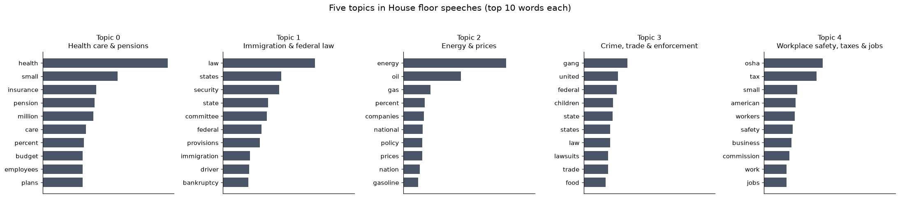
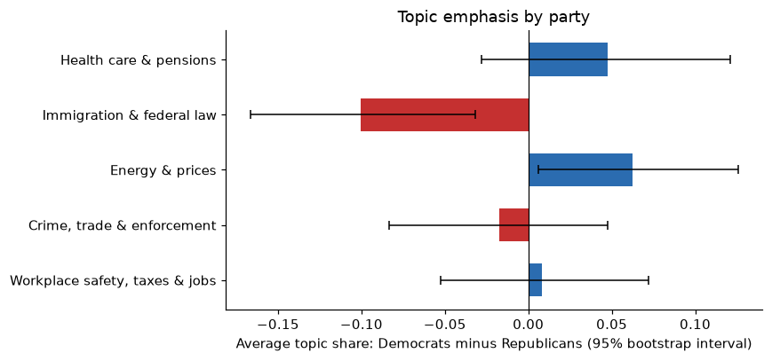
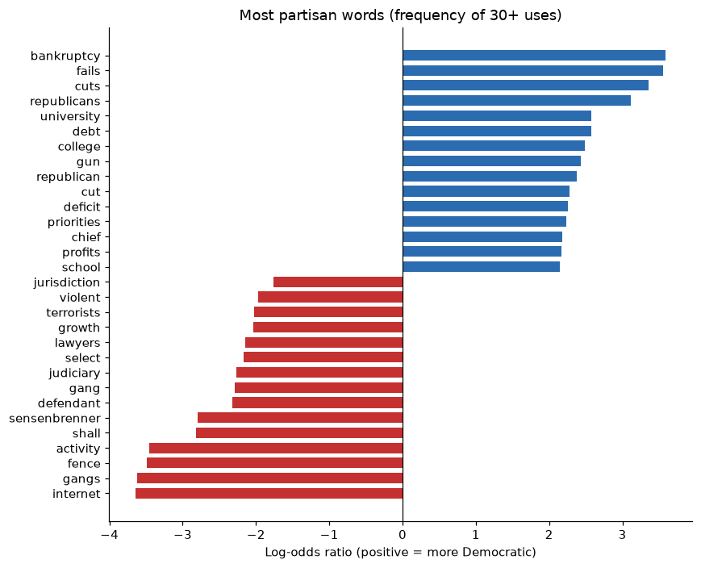

# Do Democrats and Republicans Talk About the Same Issues Differently?

Topic modeling and party-specific word embeddings on U.S. House floor speeches.

Originally a project for UC Berkeley INFO 159/259 (Natural Language Processing), unsupervised methods unit.

## Question

1. What issues dominate a set of congressional floor speeches?
2. When the two parties discuss the *same* issue, do they surround it with different vocabulary?

## Data

367 speeches (168 Democratic, 199 Republican) from the [Congressional Speech (Convote) corpus](https://www.cs.cornell.edu/home/llee/data/convote.html) (Thomas, Pang & Lee, 2006). The text is lowercased and tokenized, with one speech per line and the party as the only label. The median speech is 429 words.

## Methods

| Step | Method | Why |
|---|---|---|
| Find issues | Latent Dirichlet Allocation (scikit-learn), 5 topics, on word counts | Unsupervised and interpretable. LDA models counts, so I use raw counts, not TF-IDF. |
| Compare framing | Word2Vec (gensim), one skip-gram model per party, nearest neighbors of topic seed words | Shows which words each party uses around the same issue. |
| Cross-check | Smoothed log-odds ratio of word frequency, Democrat vs Republican | Count-based, so it does not depend on embedding quality. |
| Uncertainty | Bootstrap (2,000 resamples) on the topic-share gap between parties | Shows which differences are larger than sampling noise. |

Because the embedding corpus is small (about 45,000 tokens per party), each model is trained with 5 random seeds, and **only neighbors that appear in the top 10 for all 5 seeds are reported**.

## Results

### Five topics



The topics are health care and pensions; immigration and federal law; energy and prices; crime, trade and enforcement; and workplace safety, taxes and jobs. The labels are my interpretation of the top words. The crime and trade topic is the least clean.

### Which topics does each party emphasize?



Only two gaps are distinguishable from noise. Republican speeches give more weight to **immigration and federal law** (27% vs 17%), and Democratic speeches give more weight to **energy and prices** (16% vs 10%). The other three gaps have intervals that include zero.

### Same issue, different framing

Neighbors that were stable across all 5 seeds:

| Issue | Democrats | Republicans |
|---|---|---|
| Energy | reliance, decrease, **fossil**, dependence, **sources**, **imports** | dependence, **capacity**, **exploration**, reliance, **production**, **refining** |
| Taxes & jobs | **richest**, reconciliation, extend, **wealthy**, gains, raises | **seniors**, extension, **hire**, earned, succeed, **retirement** |
| Immigration | detention, patrol, agents, borders, homeland | roads, **illegal**, patrol, **gaps**, agents |

Both parties are close to *dependence* and *reliance* on energy. The difference is what comes with them: Democratic neighbors point toward fossil fuels and imports (reducing reliance), and Republican neighbors point toward production and refining (increasing supply). On taxes, Democratic speeches sit near *wealthy* and *richest*, and Republican speeches sit near *seniors*, *retirement* and *hire*.

The Democratic neighbors for *crime and enforcement* were names and titles from quoted letters, not policy language. I treat that result as unusable and say so in the notebook.

### Most partisan words overall



Democratic speeches lean toward budget and education words (*cuts, deficit, college, school*) and name the other party. Republican speeches lean toward law-and-order words (*gangs, defendant, judiciary, terrorists*). Some entries are specific to the debates in the sample, such as *bankruptcy* and a committee chair's surname.

## Limitations

- **Small corpus.** Embeddings from about 45,000 tokens per party are noisy. The stability filter reduces this problem but does not remove it.
- **Limited debate period.** Topics reflect the specific bills in this sample, not Congress in general.
- **Subjective choices.** *k* = 5, the topic labels, the seed words and the procedural stopword list are my judgment. *k* was not tuned with coherence or perplexity.
- **Associations only.** Neighbor differences describe word usage, not intent, and I ran no significance test on them.
- **Confounding.** Party is mixed with speaker, committee and bill, so vocabulary differences are not purely partisan.

## Revisions from the original submission

Reviewing the original homework notebook, I found two pipeline bugs that undermined its conclusions:

1. **LDA was trained on a single document.** Tokenizing the whole file at once discarded the line breaks, so splitting on newlines afterward returned one "document". The five topics therefore came from a one-row matrix, which is why the last topic looked incoherent.
2. **Word2Vec was trained on one speech.** The preprocessing function reset its output inside the loop, so only the last speech was returned. Each word was then passed through `simple_preprocess` as if it were a sentence. The embeddings had almost no context to learn from, so the original conclusion that the models gave no insight was a result of the bug and not a finding about the data.

I rewrote the pipeline with one document per speech and sentence-level Word2Vec training, and added the seed-stability filter, bootstrap intervals and log-odds cross-check. The topics are now coherent, and the energy and tax framing differences above did not appear in the original output.

## Run it

```bash
python -m venv .venv && source .venv/bin/activate
pip install -r requirements.txt
jupyter notebook analysis.ipynb
```

The notebook reads the three `*_speeches.txt` files from the project root and writes figures to `figures/`. Seeds are fixed, so results should reproduce on the same library versions.

## Project layout

```
analysis.ipynb          # full analysis with outputs
democrat_speeches.txt   # one speech per line
republican_speeches.txt # one speech per line
figures/                # figures used in this README
requirements.txt
```

## Reference

Thomas, M., Pang, B., & Lee, L. (2006). Get out the vote: Determining support or opposition from Congressional floor-debate transcripts. *EMNLP 2006*.
